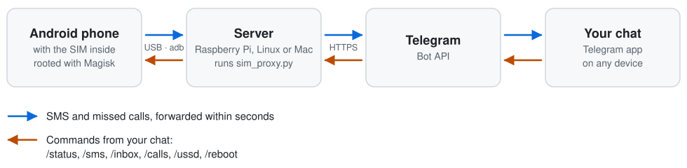

# sim-proxy

Forward SMS and missed calls from a rooted Android phone to Telegram, and
control the phone from Telegram.

The phone lives on a shelf, plugged into a small always-on computer (a
Raspberry Pi, any Linux box or a Mac) over USB. sim-proxy runs on that
computer and talks to the phone through ADB. Nothing is installed on the
phone apart from root.

It is meant for a SIM that has to stay in one place while you don't: a
number that receives 2FA codes, bank notifications or calls from people who
only know that number.

## How it works

<picture>
  <source media="(max-width: 600px) and (prefers-color-scheme: dark)" srcset="docs/images/how-it-works-tall-dark.svg">
  <source media="(max-width: 600px)" srcset="docs/images/how-it-works-tall-light.svg">
  <source media="(prefers-color-scheme: dark)" srcset="docs/images/how-it-works-wide-dark.svg">
  
</picture>

- Every `POLL_INTERVAL` seconds sim-proxy asks the phone for new SMS and
  missed calls with `adb shell su -c 'content query ...'`.
- It remembers how far it has forwarded in `~/.sim-proxy/state.json`, and
  moves that mark only after Telegram has accepted the message. If the
  server, the phone or the network goes down, nothing is lost: once
  everything is back, whatever arrived meanwhile is sent.
- On the very first start it marks everything already on the phone as seen
  and does not flood you with old messages.
- Commands are accepted only from the chat in `TELEGRAM_CHAT_ID`. Messages
  from anyone else are ignored without a reply.

More detail: [docs/how-it-works.md](docs/how-it-works.md).

## Features

- Incoming SMS forwarded in full, including multi-line and very long
  messages
- Missed call notifications, including withheld numbers
- Send an SMS from Telegram (`/sms`) through Google Messages and get told
  whether it was actually sent
- USSD requests (`/ussd`) with the reply read from the phone's screen
- Health check on start and after the phone reconnects: model, SIM number,
  battery, operator, signal in dBm, whether SMS can be read
- Alerts when the phone is gone or cannot be read, sent once per problem,
  with a message when it recovers
- Runs as a LaunchAgent (macOS) or a systemd user service (Linux) and
  restarts on failure
- Python standard library only, no dependencies

Only SMS are forwarded. RCS chats and MMS are stored elsewhere on the phone
and never reach sim-proxy, so the phone guide turns RCS off. Codes from banks
and services are plain SMS.

## Telegram commands

| Command | What it does |
|---|---|
| `/status` | Model, SIM number, battery, operator, signal, phone uptime |
| `/sms +447700900123 text` | Send an SMS from the phone and report whether it went out |
| `/inbox [N]` | Last N SMS (default 5, up to 20) |
| `/calls [N]` | Last N calls (default 5, up to 20) |
| `/ussd *100#` | Send a USSD request and return the reply shown on the phone |
| `/reboot` | Reboot the phone |
| `/help` | List of commands |

## Requirements

**Phone**
- **A Google Pixel is recommended** (6a or newer, second-hand is fine).
  sim-proxy is tested on a Pixel 6a with Android 16. Google allows unlocking
  the bootloader officially and publishes factory images, which makes root
  straightforward. Other phones work if their bootloader can be unlocked, but
  some setup steps are Pixel-specific; the
  [phone guide](docs/android-setup.md) marks them.
- Root with [Magisk](https://github.com/topjohnwu/Magisk).
- Google Messages as the default SMS app (only needed for `/sms`).
- A data-capable USB cable.

**Server**
- Linux (tested on Raspberry Pi OS / Debian) or macOS
- Python 3.8+
- `adb` from Android SDK platform-tools
- `curl`

**Telegram**
- A bot token from [@BotFather](https://t.me/BotFather)
- Your chat id (ask [@userinfobot](https://t.me/userinfobot))

## Setup

1. **Prepare the phone:** [docs/android-setup.md](docs/android-setup.md).
   Unlocking the bootloader wipes the phone, so do this first.
2. **Prepare the server:** [docs/server-setup.md](docs/server-setup.md).
3. **Install:**

   ```bash
   git clone https://github.com/totruok/sim-proxy.git
   cd sim-proxy
   ./install.sh
   ```

   `install.sh` checks for `adb`, `python3`, `curl`, a connected phone and
   root, asks for the bot token, chat id, device serial and poll interval,
   writes `.env`, sends a test message to Telegram, then installs and starts
   the service. Press **Start** in the chat with your bot before running it:
   a bot cannot write to you until you do.

4. **Check it end to end:** you should get a health check message, `/status`
   should answer, and a real SMS sent to the SIM should arrive in the chat.
   The full checklist is in [docs/server-setup.md](docs/server-setup.md#5-verify-it-for-real).

## Configuration

`.env` next to `sim_proxy.py` (see [.env.example](.env.example)):

| Variable | Meaning | Required |
|---|---|---|
| `TELEGRAM_BOT_TOKEN` | Bot token from @BotFather | yes |
| `TELEGRAM_CHAT_ID` | The only chat that receives messages and may send commands | yes |
| `ADB_DEVICE_SERIAL` | Serial from `adb devices`, needed only if several phones are connected | no |
| `POLL_INTERVAL` | Seconds between checks of the phone, 2 to 300, default 10. A whole number outside that range is moved to the nearest end; anything else means 10. Either way you get a warning in the chat | no |
| `TELEGRAM_PROXY` | HTTP proxy for Telegram, for example `http://127.0.0.1:10809`, where api.telegram.org is blocked | no |

## Managing the service

**macOS**

```bash
launchctl unload ~/Library/LaunchAgents/com.sim-proxy.plist   # stop
launchctl load ~/Library/LaunchAgents/com.sim-proxy.plist     # start
```

**Linux**

```bash
systemctl --user status sim-proxy
systemctl --user restart sim-proxy
journalctl --user -u sim-proxy -f
```

**Logs** (both): `tail -f ~/.sim-proxy/sim-proxy.log`

## Security model

Read this before you point a SIM that receives 2FA codes at it.

- **Your Telegram account becomes the second factor.** Whoever controls the
  chat gets every SMS, can read the whole inbox with `/inbox` and can send
  SMS from your number. Protect the account: cloud password on, no unknown
  sessions.
- **The bot token is a secret.** Keep `.env` out of git (it is in
  `.gitignore`). With the token someone can impersonate the bot.
- **The phone is wide open on purpose.** It is rooted, has USB debugging on,
  no screen lock and no SIM PIN, otherwise it could not recover on its own
  after a power cut. Anyone who can touch it owns it and the SIM, so keep it
  somewhere physically safe.
- **The server controls the phone.** The adb key in `~/.android/adbkey` gives
  root on the phone to anyone with a shell on the server, and the adb server
  listens on `localhost:5037` without a password, so any program running on
  the server can use it too. Do not share the server with people you would
  not give the SIM to.
- **SMS text goes through Telegram's servers.** Bot chats are not end-to-end
  encrypted.
- sim-proxy only makes outgoing HTTPS requests. It opens no ports.

## Troubleshooting

- **Commands are lost, Telegram returns `409 Conflict`:** two programs are
  polling the same bot token. Run exactly one instance per bot; use a separate
  bot for each phone.
- **macOS: `protocol fault (couldn't read status)` or `daemon not running`
  errors:** the adb server is crashing. `install.sh` sets `ADB_LIBUSB=0` for
  the service; check that it is in effect with `ADB_LIBUSB=0 adb server-status`
  (should say `usb_backend: NATIVE`). Details in
  [docs/server-setup.md](docs/server-setup.md#troubleshooting).
- **`unauthorized` in `adb devices`:** confirm the "Allow USB debugging"
  prompt on the phone and tick "Always allow".
- **The install test message does not arrive:** open the chat with your bot
  and press Start, then run `install.sh` again.
- More in [docs/android-setup.md](docs/android-setup.md#troubleshooting) and
  [docs/server-setup.md](docs/server-setup.md#troubleshooting).

## Development

```bash
python3 -m unittest discover -s tests
```

The tests drive `sim_proxy.py` against a fake phone that answers like
Android's `content` tool and a fake Telegram, so no phone, adb or network is
needed. They take well under a second. Implementation notes are in
[docs/how-it-works.md](docs/how-it-works.md).

## License

[MIT](LICENSE)
